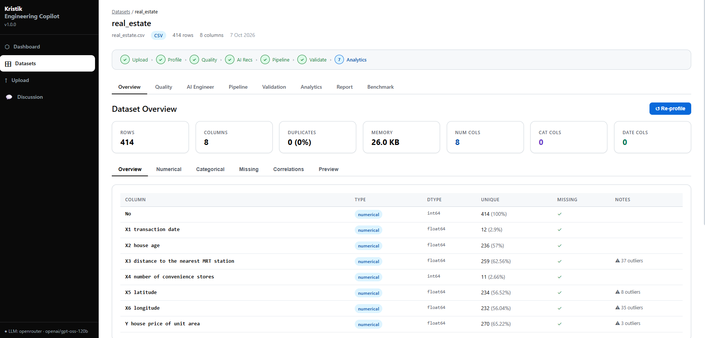
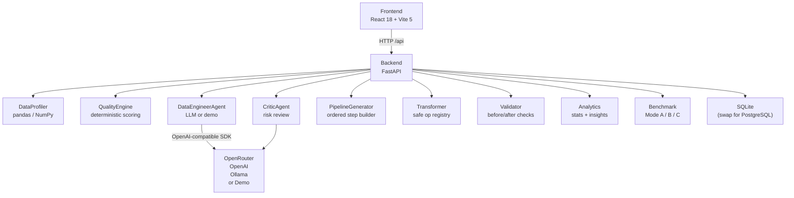

<p align="center">
  <h1 align="center">🔬 Kristik.ai — AI Data Engineering Copilot</h1>
  <p align="center">
    Upload a dataset. Get a quality score. Let AI recommend and execute a cleaning pipeline. Validate. Export.
  </p>
  <p align="center">
    
    
    
    
    
    
  </p>
</p>

<p align="center">
  
</p>

---

## 📌 Overview

Data engineering teams spend a disproportionate amount of time on repetitive cleaning tasks — identifying missing values, removing duplicates, standardising categories, detecting outliers, and writing boilerplate transformation code.

**Kristik.ai** automates the initial data quality assessment and pipeline generation workflow. It combines deterministic Python analysis with optional LLM interpretation (OpenRouter, OpenAI, Ollama, or fully offline Demo Mode) to go from raw CSV/XLSX to a validated, cleaned dataset in minutes.

---

## ✨ Features

- 📁 **Dataset Upload** — drag & drop CSV or XLSX, up to 50 MB; streamed to disk without buffering the whole file in memory
- 📊 **Automatic Data Profiling** — row/column counts, dtypes, missing values, duplicates, outliers, correlations, categorical distributions
- 🏆 **Deterministic Quality Score** — 0–100 score computed from documented weights (never estimated by the LLM)
- 🤖 **AI Data Engineer** — LLM-generated cleaning recommendations grounded in the real profile data; falls back to rule-based logic if the LLM fails
- 🎯 **Critic Agent** — secondary review of each recommendation for risk and data-loss potential (`accepted / modified / rejected`)
- 🔧 **Pipeline Builder** — visual step-by-step pipeline generated from approved recommendations; generates readable Python reference code
- ✅ **Safe Execution** — transformations run via a validated operation registry; no `eval()`, no arbitrary code
- 📋 **Validation** — before/after comparison across 6 checks (row count, column count, schema, missing values, duplicates, integrity)
- 📈 **Analytics** — descriptive stats, distributions, correlation heatmap, categorical summaries, time-series aggregation, business insights
- ⚖️ **Benchmark** — compare three modes: Deterministic (A), AI (B), AI+Critic (C) on the same dataset
- 💬 **Discussion / RAG Chat** — conversational Q&A over your dataset using the configured LLM
- 🎭 **Demo Mode** — fully functional offline without any API key
- 📄 **JSON Report Export** — full data engineering report as a downloadable JSON file

---

## 🏗️ Architecture



### 📂 Project structure

```
agnetForData/
├── backend/
│   ├── app/
│   │   ├── agents/          # LLM providers, DataEngineerAgent, CriticAgent, Benchmark
│   │   ├── api/             # FastAPI routers: datasets, analysis, benchmark, chat
│   │   ├── core/            # config.py (pydantic-settings), database.py, logging
│   │   ├── models/          # SQLAlchemy ORM models
│   │   ├── schemas/         # Pydantic request/response models
│   │   └── services/        # profiler, quality_score, transformer, validator, analytics
│   ├── scripts/             # test_llm.py smoke test, test_openrouter_live.py
│   ├── tests/               # pytest suites (164 tests)
│   ├── requirements.txt
│   └── Dockerfile
├── data/                    # sample dataset (sales_data.csv)
├── docs/                    # screenshot.png
├── frontend/
│   ├── src/
│   │   ├── api/client.js    # fetch wrapper, proxied to :8000
│   │   ├── components/      # Layout, WorkflowBar, LogStream, MiniBarChart, QualityScore
│   │   └── pages/           # Dashboard, Datasets, Upload, Profile, Quality, AI Engineer,
│   │                        # Pipeline, Validation, Analytics, Report, Benchmark, Discussion
│   └── Dockerfile
├── .env.example
├── docker-compose.yml
├── start_backend.ps1
└── start_frontend.ps1
```

---

## 📊 Data Quality Score

The score is computed deterministically from pandas/NumPy — the LLM **never** invents numbers.

| Dimension | Max Points | What is measured |
|---|---|---|
| Missing values | 30 | % null per column, weighted by column count |
| Duplicates | 20 | % exact duplicate rows |
| Outliers (IQR) | 15 | % values beyond 1.5× IQR per numerical column |
| Inconsistent categories | 15 | Mixed-case / variant detection per categorical column |
| Invalid / unparsed dates | 10 | Date-like strings that could not be parsed |
| Type anomalies | 10 | High-unique-% object columns (potential ID misclassification) |
| **Total** | **100** | |

---

## 🤖 LLM Providers

| Provider | `LLM_PROVIDER` | Needs key | Notes |
|---|---|---|---|
| Demo (offline) | `demo` | No | Deterministic rule-based logic. Default. |
| OpenRouter | `openrouter` | Yes | Supports many models (Qwen, Llama, Mistral, …). `LLM_BASE_URL` is auto-filled. |
| OpenAI | `openai` | Yes | Direct OpenAI API. |
| Ollama | `ollama` | No | Local models. Set `LLM_BASE_URL=http://localhost:11434`. |

**Fallback behaviour:** if the configured LLM fails (network error, 429, bad JSON), the agent automatically falls back to Demo Mode and logs a warning. The endpoint always returns a valid response — never HTTP 500 due to an LLM failure.

**Demo Mode** is the default. The UI shows a yellow banner when no key is configured.

---

## 🚀 Quick Start

### Prerequisites
- Python 3.11+
- Node.js 18+

### Backend

```bash
# From the project root
cd backend
python -m pip install -r requirements.txt

# Copy and configure environment
cp ../.env.example ../.env
# Edit .env — set LLM_API_KEY if using a real provider

# Start
python -m uvicorn app.main:app --host 0.0.0.0 --port 8000 --reload
```

### Frontend

```bash
cd frontend
npm install
npm run dev        # http://localhost:5173
```

Interactive API docs: **http://localhost:8000/docs**

### PowerShell scripts (Windows)

```powershell
.\start_backend.ps1
.\start_frontend.ps1
```

### Docker (optional)

```bash
docker-compose up --build
```

---

## ⚙️ Configuration

Copy `.env.example` to `.env` and edit. **Never commit `.env`** — it is in `.gitignore`.

<details>
<summary>All configuration variables</summary>

```env
# Application
APP_NAME=AI Data Engineering Copilot
APP_VERSION=1.0.0
DEBUG=false

# Database — SQLite default; swap for PostgreSQL in production
DATABASE_URL=sqlite:///./data/copilot.db

# File upload
UPLOAD_DIR=uploads
MAX_UPLOAD_SIZE_MB=50

# LLM — leave empty for Demo Mode (fully offline, no key needed)
LLM_PROVIDER=demo          # demo | openrouter | openai | ollama
LLM_MODEL=                 # model ID from your provider — see below
LLM_API_KEY=               # never commit a real key
LLM_BASE_URL=              # auto-filled for openrouter; set for ollama

# CORS
CORS_ORIGINS=["http://localhost:5173","http://localhost:3000"]
```

**OpenRouter example:**
```env
LLM_PROVIDER=openrouter
LLM_MODEL=<model-id-from-openrouter.ai/models>
LLM_API_KEY=your_openrouter_key_here
# LLM_BASE_URL is auto-set to https://openrouter.ai/api/v1
```

> ⚠️ Models with a `:free` suffix on OpenRouter are free but may be **rate-limited (HTTP 429)** or temporarily **unavailable (HTTP 404)**. Remove `:free` or choose a paid model for production use.
>
> `LLM_MODEL` must be explicitly set — there is no default model. The app starts in Demo Mode if `LLM_MODEL` is empty.

</details>

---

## 🧪 Tests

```bash
cd backend
python -m pytest tests/ -v
```

**164 tests, 0 failures** (unit + integration, covering profiler, quality engine, transformer, validator, analytics, critic agent, API endpoints).

Smoke-test the LLM provider:

```bash
python scripts/test_llm.py
```

---

## 🔌 API Reference

<details>
<summary>Full endpoint list</summary>

| Method | Endpoint | Description |
|---|---|---|
| `GET` | `/api/health` | Health check — returns provider, model, demo_mode |
| `GET` | `/api/datasets/dashboard` | Dashboard aggregate statistics |
| `POST` | `/api/datasets/upload` | Upload CSV or XLSX (multipart) |
| `GET` | `/api/datasets` | List all datasets |
| `GET` | `/api/datasets/{id}` | Get dataset metadata |
| `DELETE` | `/api/datasets/{id}` | Delete dataset and file |
| `GET` | `/api/datasets/{id}/preview` | First N rows preview (default 50, max 500) |
| `POST` | `/api/datasets/{id}/profile` | Run / re-run data profiling |
| `GET` | `/api/datasets/{id}/profile` | Get stored profile |
| `POST` | `/api/datasets/{id}/quality` | Compute quality score |
| `GET` | `/api/datasets/{id}/quality` | Get quality report |
| `POST` | `/api/datasets/{id}/recommendations` | Generate AI recommendations |
| `GET` | `/api/datasets/{id}/recommendations` | Get stored recommendations |
| `PATCH` | `/api/datasets/{id}/recommendations/{rid}` | Apply or reject a recommendation |
| `POST` | `/api/datasets/{id}/pipeline/generate` | Generate pipeline from applied recommendations |
| `POST` | `/api/datasets/{id}/pipeline/{pid}/execute` | Execute pipeline |
| `GET` | `/api/datasets/{id}/pipeline` | Get all pipelines for dataset |
| `GET` | `/api/datasets/{id}/validation` | Get validation results |
| `GET` | `/api/datasets/{id}/analytics` | Get analytics (stats, distributions, insights) |
| `GET` | `/api/datasets/{id}/logs` | Get execution logs |
| `GET` | `/api/datasets/{id}/report` | Get full JSON report |
| `POST` | `/api/benchmark/{id}` | Run Mode A/B/C benchmark |
| `GET` | `/api/conversations` | List chat conversations |
| `POST` | `/api/conversations` | Start a new conversation |
| `GET` | `/api/conversations/{id}` | Get conversation with messages |
| `POST` | `/api/conversations/{id}/messages` | Send a chat message |

Interactive docs at **http://localhost:8000/docs**

</details>

---

## ⚠️ Limitations

- **SQLite** is the default database. Not suitable for concurrent multi-user production use — replace `DATABASE_URL` with PostgreSQL.
- **No authentication or authorisation.** Every user has full access to every dataset. Add an auth layer before any multi-user deployment.
- **File size limit** is 50 MB (configurable via `MAX_UPLOAD_SIZE_MB`). Larger files may be slow to profile.
- **Pipeline execution** transforms an in-memory copy; the original uploaded file is never overwritten.
- **PDF export** is not implemented — JSON report export is available.
- **CriticAgent** on free-tier OpenRouter models may hit HTTP 429 rate limits and fall back to demo critic logic.

---

## 🗺️ Roadmap

- [ ] Authentication (API keys or OAuth2)
- [ ] PostgreSQL support with connection pooling
- [ ] PDF report export
- [ ] Scheduled pipeline runs
- [ ] Direct database connections (PostgreSQL, MySQL)
- [ ] Streaming pipeline execution with real-time progress
- [ ] Multi-tenant workspace isolation
- [ ] Column-level data lineage tracking

---

## 👤 Author

**Naceur Ahmed**
GitHub: [@enaceur-ahmed](https://github.com/enaceur-ahmed)
